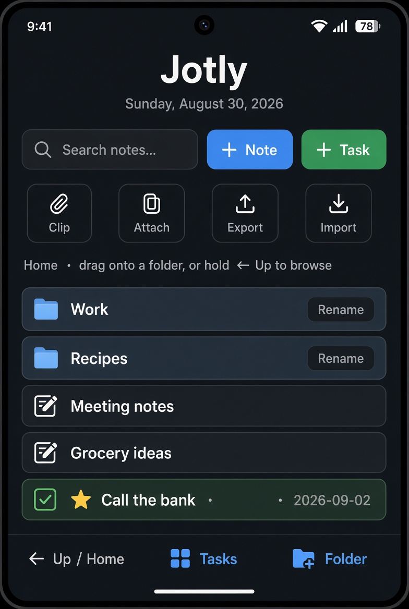
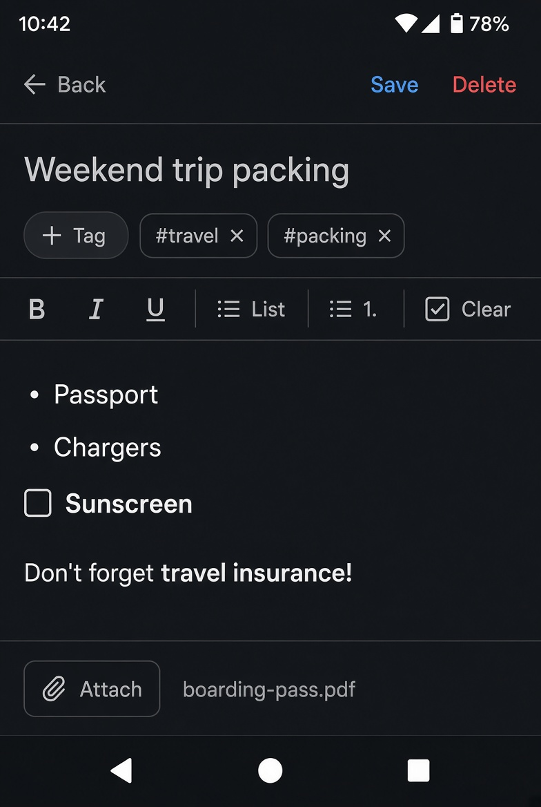
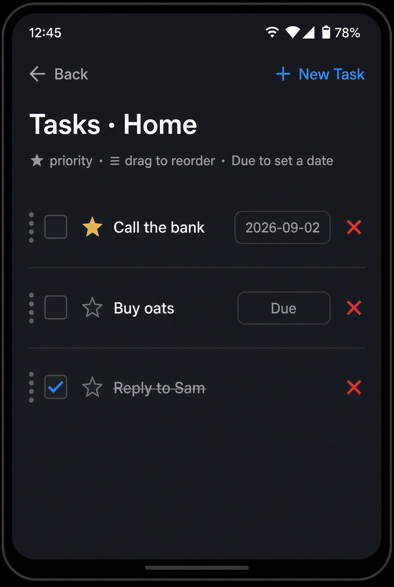

# Jotly

A local-first notes and tasks app in the spirit of Evernote. Built with Python and Kivy so the same code runs on the desktop while you develop and packages to Android with Buildozer.

Jotly keeps everything on-device in SQLite. There is no account and no cloud unless you export a backup yourself.



## What it does

### Notes
- Create, edit, and delete notes with a title and body
- Rich text via BBCode: **bold**, *italic*, underline
- Lists in the editor: bullets (`•`), numbered (`1.`), and checkboxes (`☐` / `☑`)
- Attach files to a note; copies live under the app data directory
- Tag notes (`#work`, `#recipes`, …) and strip a tag with one tap
- Auto-save when you leave the editor; Save flashes “Saved”



### Folders
- Nested folders with a breadcrumb path (`Home › Work › Q3`)
- Rename folders in place
- Drag a note onto a folder row (or Home) to file it
- Hold **← Up / Home** for about 0.7s to open a folder tray; hold a chip with `›` to drill into subfolders, then drop the note on a chip

### Tasks
- Tasks belong to the current folder (or Home)
- Toggle complete, star for priority, and delete in the list — no extra screen
- Due dates from a month calendar popup (Clear / Today / tap a day)
- Drag the `≡` handle to reorder; order is saved
- Home preview shows open tasks; the Tasks screen shows completed ones too



### Search and capture
- Live search (120ms debounce) over note titles and bodies using SQLite FTS5
- `#tag` in the search box filters by tag (`#work packing`)
- **Clip** pastes text or a URL into a new note (URLs get a `#clip` tag)
- **Attach** files a document into a new inbox note
- On Android, sharing text into Jotly (`SEND`) creates a note from the share

### Backup
- **Export** writes a zip archive (`jotly.json` + attached files)
- **Import** restores folders, notes, tasks, tags, and attachments from that zip

### Look and feel
- Dark slate theme, portrait layout
- Short 120ms slide between screens
- Data file: `<App.user_data_dir>/jotly.db`

Not in this build: due-date notifications and calendar export.

## Stack

| Piece | Choice |
| --- | --- |
| Language | Python 3.12+ |
| UI | Kivy 2.3.0 |
| Storage | SQLite (`jotly.db`) with FTS5 on notes |
| Android | Buildozer (`org.jotly.jotly`, API 33, min 21) |

Layout:

```
main.py                  app entry, ScreenManager
database/db_manager.py   schema, FTS5 triggers, PRAGMA foreign_keys=ON
models/                  Note, Task, Folder, Tag, Attachment, Capture, Backup
ui/screens/              home, note editor, task list
ui/widgets/              editor, date picker, folder tray, dialogs
ui/theme.py              colors and buttons
tests/                   manager and smoke tests
```

## Installation

### Run on desktop (the usual way)

You need Python 3.12+ (Kivy 2.3.0 lacks prebuilt wheels for 3.13) and a working display (Linux, macOS, or Windows).

```bash
git clone https://github.com/Weston-Matthews/jotly.git
cd jotly

python3 -m venv .venv
source .venv/bin/activate          # Windows: .venv\Scripts\activate

pip install --upgrade pip
pip install -r requirements.txt    # installs kivy==2.3.0

python main.py
```

The window should open on the home screen. Create a note, a task, and a folder to confirm it is working. The database is created in Kivy’s user data directory on first launch, not next to `main.py`.

If `pip` cannot find a Kivy wheel for your platform, use the [Kivy install guide](https://kivy.org/doc/stable/gettingstarted/installation.html) for that OS.

Optional checks:

```bash
pip install pytest
python -m pytest tests/
```

### Build an Android APK

Desktop first. The first Buildozer run downloads the Android SDK/NDK and takes a while.

```bash
pip install buildozer cython

# Debian/Ubuntu build hosts
sudo apt install -y git zip unzip openjdk-17-jdk python3-pip autoconf libtool \
    pkg-config zlib1g-dev libncurses5-dev libncursesw5-dev libtinfo5 cmake \
    libffi-dev libssl-dev

buildozer android debug
```

The APK lands under `bin/` (package `org.jotly.jotly`, version `0.1`). Install on a device with USB debugging on:

```bash
adb install -r bin/*.apk
```

Logs: `adb logcat | grep python`

See [Buildozer installation](https://buildozer.readthedocs.io/en/latest/installation.html) for other host OSes. `buildozer.spec` already sets portrait orientation and storage permissions.

## Using the app

1. **+ Note** — title, format the body, add tags, attach a file, Save or Back.
2. **+ Task** — checkbox, star, due date, drag to reorder on the Tasks screen.
3. **+ Folder** — nest notebooks; drag notes onto a folder or hold **← Up / Home** to browse.
4. Search as you type. Prefix a word with `#` to match a tag.
5. **Clip / Attach** for a fast inbox. **Export / Import** for a portable backup.

## More docs

- [QUICKSTART.md](QUICKSTART.md) — short first-run walkthrough
- [ARCHITECTURE.md](ARCHITECTURE.md) — screens, managers, and data flow
- [TIPS.md](TIPS.md) — Android workflow and debugging notes
